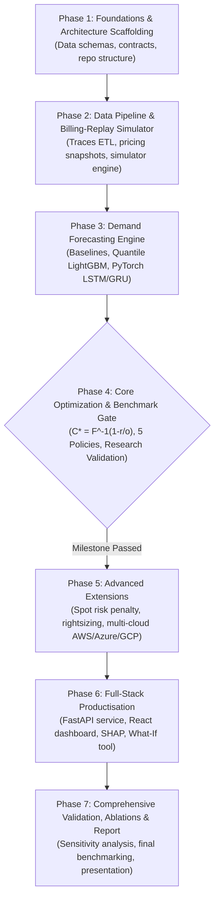

# Uncertainty-Aware Cloud Cost Optimization System: Master Project Plan

## Executive Overview
The goal of this project is to build and empirically validate an end-to-end cloud cost optimization system that answers the core research question:
> **Does forecast-based commitment sizing that accounts for uncertainty cost less than the lookback rule used by provider tools, by how much, and for which kinds of workload (flat, seasonal, growing, bursty)?**

The project balances two critical tracks:
1. **Research & Algorithmic Track**: Quantile forecasting, newsvendor-based optimal commitment ($C^* = F^{-1}(1 - r/o)$), Spot interruption risk modeling, and a rigorous billing-replay simulator tested against real workloads and pricing.
2. **Software Engineering & Productisation Track**: A clean modular Python core, FastAPI REST service, SHAP-driven explainability, and a modern React dashboard with interactive "What-If" simulation.

---

## Phased Master Roadmap

---

## Detailed Phase Breakdown

### Phase 1: Foundations & Architecture Scaffolding
- **Objective**: Establish the software architecture, coding standards, environment setup, and data contracts before writing model or simulator code.
- **Key Deliverables**:
  1. **Workspace Structure**: Clean directory hierarchy separating `data/`, `src/` (pipeline, pricing, forecasting, optimizer, simulator, api), `web/`, `notebooks/`, and `tests/`.
  2. **Environment & Dependencies**: `pyproject.toml` / `requirements.txt` pinning core scientific and ML libraries (`numpy`, `pandas`, `scipy`, `statsmodels`, `lightgbm`, `torch`, `fastapi`, `pydantic`).
  3. **Domain Schemas (Data Contracts)**:
     - `WorkloadTrace`: Hourly timestamp, vCPU demand, memory demand, workload metadata (type: flat, seasonal, growing, bursty).
     - `PricingSnapshot`: Provider (AWS, Azure, GCP), instance family, region, On-Demand rate ($o$), Reserved/Savings Plan effective rate ($r$), Spot average & interruption frequency.
     - `PolicyRecommendation`: Sized commitment $C^*$, expected spot fraction, predicted total cost, confidence interval.
     - `SimulationResult`: Actual bill breakdown (On-Demand cost, Reserved cost, Spot cost, unutilized reservation waste, overflow cost).

---

### Phase 2: Data Pipeline & Billing-Replay Simulator (The Ground Truth Engine)
- **Objective**: Ingest real trace datasets, categorize workloads, build pricing adapters, and construct an authoritative replay simulator that accurately calculates bills down to the hour.
- **Key Deliverables**:
  1. **Dataset Ingestion**:
     - Parsers for Azure Public Dataset (VM traces) and Alibaba Cluster Trace.
     - Synthetic / benchmark trace generators for controlled edge cases (pure sinusoid, step-function growth, Poisson bursts).
     - Normalization into standardized hourly vCPU-hour time series.
  2. **Workload Classification Engine**:
     - Automated labeling of traces into the 4 target categories: **Flat**, **Seasonal/Diurnal**, **Growing/Trending**, and **Bursty**.
     - Statistical profiling (coefficient of variation, autocorrelation, trend slope).
  3. **Pricing Snapshots**:
     - Local static snapshots for AWS (e.g., `m5.large`, `c5.xlarge`, `r5.large` in `us-east-1` for On-Demand, 1-yr / 3-yr No-Upfront, and Spot).
     - Extensible interface for Azure and GCP pricing.
  4. **Billing-Replay Simulator**:
     - Replays any buying policy against an unseen workload trace hour-by-hour:
       $$\text{Hourly Cost}_t = r \cdot C + \begin{cases} o \cdot (D_t - C) & \text{if } D_t > C \\ 0 & \text{if } D_t \le C \end{cases}$$
       (Extended for Spot allocations when applicable).
     - Verified against official AWS Savings Plans calculator logic to ensure absolute accounting correctness.

---

### Phase 3: Demand Forecasting Engine (Predicting Uncertainty)
- **Objective**: Build and compare models that output forecast distributions / quantiles ($p_{10}, p_{50}, p_{90}$) instead of single point estimates.
- **Key Deliverables**:
  1. **Strict Time-Split Evaluation**:
     - Rolling-window train/validation/test splits (strictly no future data leakage).
  2. **Model Implementations**:
     - *Baselines*: Naive repeat last value, rolling moving averages, ETS / Auto-ARIMA with prediction intervals.
     - *Quantile Gradient Boosted Trees (LightGBM)*: Custom or pinball loss for multi-quantile multi-step horizon forecasting with lag and calendar features.
     - *Deep Learning (PyTorch)*: LSTM / GRU neural network with quantile pinball loss.
     - *Optional Advanced*: Temporal Fusion Transformer (TFT) if performance warrants.
  3. **Forecasting Metrics**:
     - Pinball loss across target percentiles, Continuous Ranked Probability Score (CRPS), MAE, and RMSE for point baselines.

---

### Phase 4: Core Optimization & Benchmark Gate (The Checkpoint)
- **Objective**: Implement the newsvendor-based commitment rule, execute the 5-policy benchmark, and empirically answer the primary research question.
- **Key Deliverables**:
  1. **The Core Optimizer**:
     - Implementation of the optimal commitment formula:
       $$C^* = F^{-1}\left(1 - \frac{r}{o}\right)$$
     - Quantile interpolation over predicted distribution percentiles.
  2. **The 5-Policy Benchmark Matrix**:
     - **Policy 1 (Reference)**: *All On-Demand* (100% pay-as-you-go).
     - **Policy 2 (Primary Baseline)**: *AWS-style Lookback* (commit sized from the past 7, 30, or 60 days of historical demand).
     - **Policy 3 (Ablation)**: *Point Forecast Policy* (commit sized solely on median/mean forecast without quantile uncertainty).
     - **Policy 4 (Proposed Method)**: *Uncertainty-Aware Commitment* with dynamic risk sizing.
     - **Policy 5 (Upper Bound)**: *Hindsight Oracle* (calculated with perfect knowledge of future demand).
  3. **Research Checkpoint Evaluation**:
     - Cost savings vs. All On-Demand.
     - Cost savings vs. Lookback heuristic across **all 4 workload types**.
     - Analysis of failure modes (e.g., when does lookback overcommit due to a past surge that declines, and by how much does our method save?).

---

### Phase 5: Advanced Extensions
- **Objective**: Enhance the optimizer with realistic operational features: Spot risk handling, instance rightsizing, and multi-cloud matching.
- **Key Deliverables**:
  1. **Spot Risk & Interruption Modeling**:
     - Interruption penalty model based on historical spot revocation statistics.
     - Workload interruptibility classifier: determining which workloads or overflow tiers are safe for Spot.
  2. **Rightsizing Recommender**:
     - Identifying over-provisioned baseline workloads (e.g., CPU utilization consistently $< 20\%$) and recommending downsized instance equivalents.
  3. **Multi-Cloud Instance Comparator**:
     - Provider-neutral workload specification (vCPUs, RAM, architecture, network).
     - Normalized mapping between AWS (e.g., `m5`), Azure (e.g., `D-series`), and GCP (e.g., `n2`).
     - Cost comparison ranking with sensitivity analysis under varying discount terms.

---

### Phase 6: Full-Stack Productisation (FastAPI + React Dashboard)
- **Objective**: Package the engine into an interactive, explainable, deployable web application.
- **Key Deliverables**:
  1. **FastAPI Backend**:
     - REST API endpoints:
       - `POST /api/workload/upload`: Upload CSV or select preset trace.
       - `POST /api/forecast`: Generate probabilistic demand forecast.
       - `POST /api/optimize`: Run commitment optimization across policies.
       - `POST /api/replay`: Execute full billing replay with cost breakdown.
       - `GET /api/multicloud/compare`: Multi-cloud cost comparison.
  2. **Explainability Module (SHAP)**:
     - SHAP feature importance explaining *why* the model recommended a specific commitment (e.g., strong seasonal cycle, high volatility, predicted downward trend).
  3. **React Frontend Dashboard**:
     - *Time Series Visualizer*: Historical demand + quantile forecast fan chart ($10\% - 90\%$).
     - *Policy Comparison Waterfall*: Side-by-side cost bar chart of the 5 policies with savings percentages.
     - *Interactive "What-If" Playground*: Sliders for provider discount ($r/o$), spot risk tolerance, and lookback window to visualize real-time cost changes.

---

### Phase 7: Validation, Sensitivity Analysis & Final Report
- **Objective**: Conduct rigorous empirical stress testing and generate final publication/project deliverables.
- **Key Deliverables**:
  1. **Sensitivity Analysis**:
     - Sensitivity to discount depths ($20\%$ to $60\%$).
     - Sensitivity to lookback windows (7 vs 30 vs 60 days).
     - Sensitivity to forecast horizon (7-day ahead vs 30-day ahead).
  2. **Comprehensive Report & Artifacts**:
     - Summary tables and publication-grade plots (Matplotlib/Seaborn/Plotly).
     - Reproducibility test suite (`pytest`) and Docker containerization.
     - Final project report writeup aligning directly with academic submission guidelines.

---

## Decision Points for Your Input

Before we lock this plan and write code, please consider and let me know your thoughts on:
1. **Initial Dataset Choice**: Should we start by downloading a sample of the **Azure Public Dataset / Alibaba trace**, or should we first construct a **synthetic generator** covering the 4 workload profiles (flat, seasonal, growing, bursty) to validate the simulator quickly?
2. **First Cloud Provider Focus**: Shall we lock in **AWS EC2 (m5/c5 families, US East)** for Phases 1–4, and then plug in Azure & GCP in Phase 5?
3. **Frontend Preference**: The report outlines a **React** web dashboard. Are you comfortable with a React/Vite + Tailwind frontend, or do you have any specific preferences?
